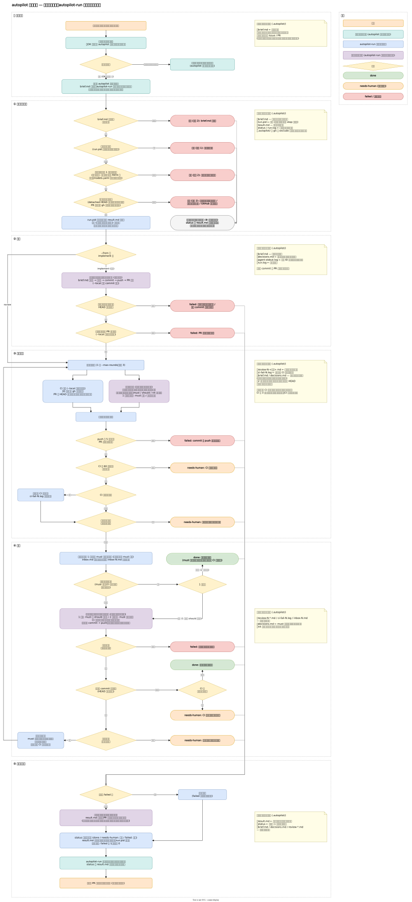
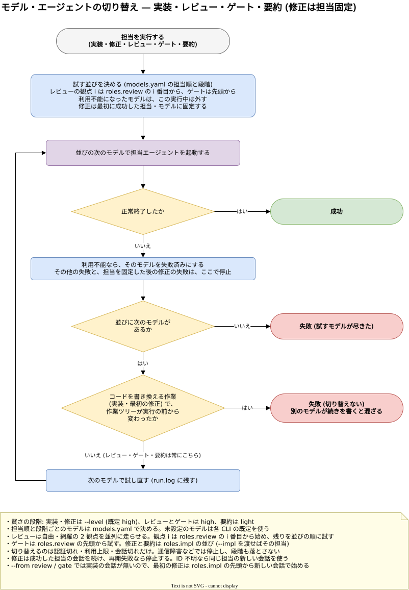
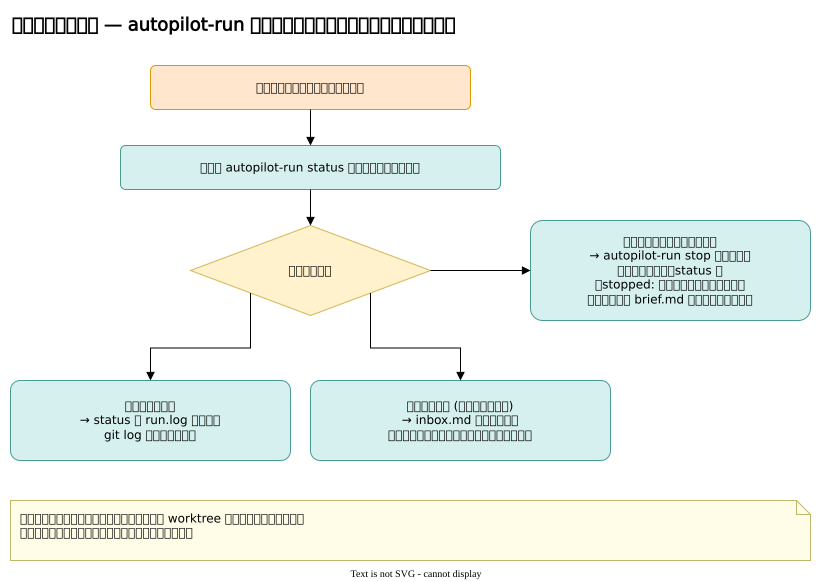

# autopilot 設計

## 1. 背景

個人開発の最大の制約は、時間の少なさと判断力の消耗である。思いついたときにスマホから仕事を投げ、裏で進んだ結果を、スキマ時間にはスマホで、まとまった時間には PC で、同じ場所から受け取りたい。

v1〜v4 は GitHub の Issue / PR を入口にして、監視・判定・キュー・実行を自前で作った。結果として状態管理と例外処理が積み上がり、エージェントの作業を人間が覗いたり口を出したりもできなかった。

v5 は作業場を Orca サーバーに移す。セッション・worktree・UI・通知は Orca に任せ、自前の仕組みは「任せた仕事を裏で完走させる」部分だけに絞る。

## 2. ユーザーストーリー

1. **一言で始める**: スマホや PC から一言でワークスペースを作ると、窓口エージェントが仕様をまとめて確認を求めてくる。
2. **OK で任せる**: 仕様に OK を返すと、実装・テスト・PR・CI・別セッションのレビュー・修正まで黙って進み、終わったときに 1 回だけ呼ばれる。
3. **細かく見たいときは一緒に進める**: 「一緒に」と言えば、窓口と対話しながら進める。
4. **迷ったら聞いてくる**: 自走中でも人間の判断が要るときは、選択肢と推奨を添えて 1 回だけ呼ばれる。
5. **どこからでも同じ**: スマホと PC で同じセッションを続けられる。PC を閉じても止まらない。
6. **途中で口を出せる**: 自走中のものを覗き、軽い指示を足したり、止めて議論したりできる。
7. **並行して投げられる**: 複数の仕事を同時に走らせ、自分の手番だけが一覧で分かる。
8. **マージは自分**: PR をマージするのは常に人間で、エージェントにはできない。
9. **記録が残る**: PR を見れば、何をなぜ決めたかが分かる。

## 3. 構成

```
 スマホ / PC の Orca ──→ Orca サーバー（orca serve）
                          ワークスペース（git worktree）
                            └ 窓口エージェント（claude / agy / codex）  ← 人間が話すのはここだけ
                                 │ OK（任せる）
                                 └→ autopilot-run（Orca からは見えない）
                                      実装 → PR → [CI 待ち ‖ 別セッションのレビュー → 修正] → ゲート → 要約
```

| 置き場 | 役割 |
|---|---|
| `home/AGENTS.md` | 全エージェント共通のルール。話し方・OK で任せる・マージしない |
| `home/skills/autopilot/` | 窓口の手順。任せ方・報告・途中の割り込み |
| `src/` | `autopilot-run`。順序と待ちを持ち、判断は LLM に任せる |
| `nix/module.nix` | `autopilot-run` を入れ、`home/` を各エージェントの読み込み先へ symlink する。共通ルールの後ろにはホストが渡すルール（`extraRules`、人間個人の約束など）を足す |

流れと分岐は、次の図に描いてある。どれも drawio の編集データを含む SVG で、drawio で開けばそのまま編集できる。

仕様合意から、`autopilot-run` の自走、報告まで



担当の実行が失敗したときの、モデルの切り替え



自走中に人間が窓口へ話しかけたときの対応



### 通知

Orca はエージェントがターンを終えると人間に通知する。窓口は任せた直後にターンを終え、`autopilot-run` の完了で起こされて報告するので、通知は「任せた時」と「終わった時」だけになる。`autopilot-run` は `ORCA_*` を外して子を起動し、途中で通知を鳴らさない。

その代わり、裏の作業は Orca にエージェントとして映らない。窓口が `orca worktree create` で子ワークスペースを作ってそこで `autopilot-run` を動かしても、子を開くとシェルのターミナルしか出ない。進み具合は窓口に聞くか、子の `.autopilot/status` と `run.log` で見る。

### 窓口とのやりとり

すべて worktree 直下の `.autopilot/` のファイルで行う（`src/state.ts`）。窓口は `brief.md` に合意内容を書いて任せ、実行中の軽い指示は `inbox.md` に追記し、終わったら `result.md` を読んで報告する。実行中は窓口がコードを書き換えない。

### モデルと賢さ

作業ごとの賢さ（段階）と、段階ごとの具体的なモデルを分けて持つ。モデルは頻繁に変わるので、モデル名はホストの `models.yaml` の 1 ファイルだけに書く。

| 作業 | 段階 | 決めるもの |
|---|---|---|
| 実装・修正 | 窓口が `--level` で選ぶ（既定 `high`） | 仕事の難しさは、会話をした窓口が一番分かっている |
| レビュー | `high` | 見落としが一番高くつく |
| ゲート | `high` | 手順の実行と変更の良否を確かめる |
| 要約 | `light` | 差分とログをまとめるだけ |

- 段階は `src/models.ts`、モデルの並びは `models.yaml`（`programs.autopilot5.models` で `/etc/autopilot5/models.yaml` に置く）が決める。
- 担当の既定は実装・要約が `agy → codex → claude`、レビューが `claude → codex → agy`。窓口の種類では変えない。レビューは「自由」と「網羅」の 2 観点に分けて並列に走らせる。観点 i の担当は `roles.review` の並びの i 番目から始め、使えなければ残りを並びの順に試す（既定では自由: `claude → codex → agy`、網羅: `codex → claude → agy`）。同じ CLI が実装していても別の会話でレビューする。
- `models.yaml` の `roles.impl` / `roles.review` で担当の優先順を上書きできる。各 CLI 内では、段階ごとのモデルを前から順に試す。`--impl` / `--reviewers` を明示したときは、その指定だけを使い、別 CLI には切り替えない（観点 i には `reviewers[i % n]` を割り当てる）。
- 切り替えるのは認証期限切れ・利用枠／レート上限・会話の期限切れ／コンテキスト上限で失敗したときだけ。通信障害・原因不明の異常終了・CLI 未導入・テスト失敗は対象外。実装で作業ツリーや HEAD が変わっていたら、途中の続きが混ざるので切り替えない。
- 一度利用不能になったモデルは、その実行の間は再利用しない。下の段階へは自動で落とさない。許すなら並びに明示する。

担当順の設定例（モデルの設定は従来どおり同じファイルに置く）:

```yaml
roles:
  impl: [agy, codex, claude]
  review: [claude, codex, agy]
```

Codex の専用 review コマンドはまだ使わず、他の CLI と同じレビュープロンプトを `codex exec` に渡す。

### 修正ループ

レビューと修正は、上限（既定 3 周）まで繰り返す。修正担当が指摘を直し続けると、その修正にまた指摘が付いて上限まで回り、1 時間ほどかかっていた。
2・3 周目に must が 1 件も無いまま回ったこともある。そこで、次のように絞る。

- レビュー担当は 1 行目に must の有無を書く。pipeline は最初に現れる「判定:」で始まる行を、Markdown の装飾と空白を除いて読む。担当が前置きを 1 行書いても判定を取りこぼさないためである。引用（`>` で始まる行）の判定は前回の結果の引き写しでありうるので、引用でない判定の行を先に読み、引用しか無いときだけ引用を読む。読めなければ must ありとみなす（見落とすより、もう 1 周する方が安い）
- レビューは観点（自由・網羅）ごとに別ファイル（`review-N-free.md` / `review-N-coverage.md`）へ保存し、末尾に実際に成功した担当（`担当: <CLI:モデル>`）を記録する。観点の全候補が失敗したら `run.log` に残し、残った観点で続ける。全観点が失敗したら needs-human。欠けた観点があった場合は要約に渡し、`result.md` に書かせる
- `Promise.all` で全観点を待ち、1 つでも must があれば must ありとみなす。修正担当にはレビューファイルを並べて渡す
- 1 周目は must と should を直し、2 周目以降は must だけを直す。nit と直さなかった指摘は、要約で人間に渡す
- must の無いレビューの後の修正は、再レビューせず CI だけ確かめる。2 周目以降のレビューに must が無ければ、修正担当を呼ばずに終える
- レビュー担当は `decisions.md` を読み、理由を付けて見送られた指摘を繰り返さない。2 周目以降は、前回レビューした HEAD からの修正を中心に見る
- レビューは CI の結果を使わないので、CI を待つ間に進める
- 修正担当は、実装担当の会話の続きで動く（claude は `--session-id` / `--resume`、agy は JSON の出力の会話 ID と `--conversation`、codex は JSONL の `thread_id` と `exec resume`）。修正のたびにコードを一から読み直す手間を省く。実装に成功した CLI とモデルを修正でも維持し、再開に失敗したら別担当へ切り替えず停止する。会話 ID が読めなければ同じ担当の新しい会話で始め、`run.log` に残す
- `--from review` と `--from gate` では実装の会話が無いので、最初の修正は新しい会話で始める。担当は実装担当と同じ並び（`--impl` を渡せばその担当）の先頭から試し、利用上限などで使えなければ次の候補へ切り替える。成功した担当とその会話を、2 回目以降の修正で続ける。修正のプロンプトは毎回 `brief.md` を読ませるので、新しい会話の修正担当も仕様に照らして直せる
- 修正担当は、レビュー指摘・CI の失敗・ゲートの不合格・人間の追加指示を読み、直すか人間に返すかを判断する。外部システムの一時的なエラーや環境・認証・権限、仕様の解釈などは判断の材料であり、コードで分類しない
- テストの削除・skip、リトライで覆う、期待値やゲートの基準を緩めるなど、失敗を隠す修正はしない。直せるものは直して commit・push し（`--local` は commit のみ）、残る理由を `.autopilot/needs-human.md` に書く。修正担当の実行直後に中身があれば、最初の空でない行を理由として needs-human で終了し、要約へ進む。起動時には古い `needs-human.md` を消す
- 実装担当・修正担当・ゲート担当の実行の後には毎回（どの周でも、HEAD が変わったかに関係なく）、`git status --porcelain=v1 --untracked-files=all` が空であることを確かめる（`.gitignore` に当たるものと `.autopilot/` は除かれる）。空でなければ、どの担当の後かと残ったファイル（多ければ先頭の 5 件と残りの件数）を理由に needs-human で終え、要約へ進む。一部だけ commit した残りを、未 commit の変更込みでゲートに確かめて done にしないためである。ゲートの後にも確かめるのは、ゲートが手順の実行で残した生成物を、次の修正担当が残したものと取り違えないためである。`needs-human.md` と重なったときは両方の理由を並べる
- 要約担当には、終わり方とその理由（`status` に書くもの）をプロンプトで渡す。`status` は要約の後に書かれ、「CI が終わらない」「修正ループが上限に達した」「未 commit のファイルが残っている」などの理由は `run.log` にしか無いので、渡さないと `result.md` と PR 本文に「人間の判断が必要なこと: なし」と書かれうる

### ゲート

リポジトリごとの検証手順を `.agents/autopilot-gate*.md` に置く。1 ファイルが 1 ゲートであり、打鍵・E2E・性能テスト・静的レビューなど、検証内容は手順書が決める。autopilot は実行する時期と結果の扱いだけを持つ。

- 基点（`baseSha`）の木から一覧と内容を読む。PR が自分の基準を緩めて通り抜けないよう、作業ツリーの手順書は使わない。その PR で初めて追加したゲートは走らない
- 基点から取り出した手順書を `.autopilot/gate-src-<名前>.md` に保存し、担当にはそのパスを渡す。名前はファイル名から接頭辞・拡張子と先頭の区切りを除く。空なら `default`、特殊文字は符号化し、160 文字を超えたら先頭部分と元のパスのハッシュに短縮する。衝突時は番号を付け、保存先のファイル名を短く保ち、結果の上書きを防ぐ
- done の直前に全ゲートを `Promise.all` で並列に走らせる。PR モードでは現在の HEAD と PR の HEAD が一致し、CI が通ってから実行する。ゲートが無ければ `run.log` に「ゲートなし」と残して終了する
- `--local` でも実行する。PR 番号が無く、必要な Preview が無い場合などは担当が対象外と判断する。静的レビューだけ先に走らせるなどの時期の書き分けはしない
- 担当は読み取り専用（`writes: false`）、賢さは `high` とする。`roles.review` の先頭から利用不能時だけ次の候補へ進む。`--reviewers` を明示した場合は先頭の担当を使い、その担当のモデル候補だけを試す。別 CLI へは切り替えない
- 手順書の「守ること」を最優先に、書かれた手順を実際に実行する。結果は `.autopilot/gate-N-<名前>.md` に保存し、末尾に `担当: <CLI:モデル>` を付ける。`run.log` にも各ゲートの判定と担当を記録する

担当は 1 行目に判定を書く。pipeline はレビューと同じく、最初に現れる「判定:」で始まる行を Markdown の装飾と空白を除いて読む。2 行目以降には実行内容・結果・失敗したコマンドなどの根拠を書く。

| 1 行目 | 次の動き |
|---|---|
| `判定: 合格` / `判定: 対象外` | 全ゲートがこのどちらかなら done |
| `判定: 不合格` | 修正担当へ結果を渡し、修正ループへ戻る |
| `判定: 判定不能` | 外部要因でコードの良否を確かめられないため、修正せず needs-human |
| 判定や手順書を読めない / 担当が失敗 | needs-human |

不合格と判定不能などが混ざったときは needs-human を優先する。ゲートの不合格だけを直した後はレビューをやり直さず、CI と全ゲートを再確認する。人間の追加指示も直した場合は再レビューする。HEAD が変わらなければ「ゲートの不合格を直せなかった」として needs-human とする。ゲートで戻った周も `--max-rounds`（既定 3）の上限に数える。上限時には未修正のゲート不合格や未処理の追加指示を理由に残す。最後の修正がゲートの不合格を直したものなら「CI と全ゲートを確かめていない」と書く。要約は各ゲートの判定と担当（対象外・判定不能を含む）、`needs-human.md` の理由を `result.md` と PR 本文に残す。

ゲートが終わったときにも追加指示を確認する。この周の修正前なら同じ周で処理し、修正後なら `inbox.md` を残して次の周で処理する。ゲートが合格しても、未処理の追加指示を残したまま done にはしない。追加指示を受けた修正担当が HEAD を変えなかったときは、その HEAD で合格済みならゲートを走らせ直さない。重いゲートを二度走らせず、1 回目の結果を上書きしないためである。inbox の依頼（「ゲートをもう一度走らせて」など）でも、合格済みの HEAD のゲートは再実行しない。合格済みの HEAD でゲートをやり直したいときは、人間（窓口）が `--from gate` で手動に再実行する。

`autopilot-run --from gate` は実装とレビューを飛ばし、現在の PR の CI を待ってゲートから始める。不合格なら通常の修正ループへ入る。`--local --from gate` は PR・CI を使わずローカルの commit を検証する。ゲートの試運転や既存 PR の再検証（合格済みの HEAD のやり直しを含む）に使うが、どちらも手順書は基点から読むため、新しい手順書の試運転には基点にその手順書が必要である。

#### ゲートの書き方

手順書には次を明記する。

1. 目的: CI だけでは何を確かめられないか
2. 前提: Preview の URL、必要な環境、検証対象
3. 手順: 実行するコマンドや操作、収集する証拠
4. 合格基準: 期待する応答や性能など、変更の良否を判断する条件
5. 対象外の条件: 変更が影響しない範囲や、PR・Preview が無い場合の扱い
6. 守ること: 読み取り専用、禁止するリクエストや操作など

環境の接続失敗などで確認できなかった場合は、不合格と区別して判定不能とする。autopilot のゲート担当はファイルを書き換えないため、手順もこの前提で用意する。

### 安全

- GitHub への書き込みは bot アカウントで行う。
- マージ・既定ブランチへの push の禁止はプロンプトに書いたうえで、GitHub の ruleset で強制する。
